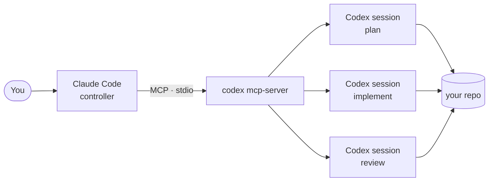

# claude-code-codex-mcp

**Run OpenAI Codex as a subagent inside Claude Code — over MCP, in about two minutes.**

Codex CLI can act as an MCP server. Claude Code is an MCP client. Put those together and Claude Code
can open Codex sessions, hand them scoped work, and read back the results — no copy-pasting between
two terminals, no browser tab in the middle.

This is the setup, the tool schemas **read from a live server** rather than copied from docs, and the
gotchas that will otherwise cost you an afternoon.



One agent holds the context and the judgment. The other does the labor, in a session you scope and
throw away.

> **Status:** Codex's MCP server interface is marked experimental upstream. Tool names have been
> stable; parameters have grown between releases. Run the verify script below against your own build
> instead of trusting any table, including this one.

---

## Quick start

```bash
# 1. Codex CLI, current
npm install -g @openai/codex@latest
codex --version                    # expect 0.146.0 or newer

# 2. Authenticate — installing the CLI does not log you in
codex login                        # or set OPENAI_API_KEY
codex exec --sandbox read-only "reply with OK"   # confirms auth actually works

# 3. Register it with Claude Code
claude mcp add codex --scope local -- codex mcp-server

# 4. Confirm it connected
claude mcp list                    # codex: codex mcp-server - ✔ Connected

# 5. Restart Claude Code.  ← not optional, see Gotcha 1
```

Step 2 is the one people skip. A fresh machine will reach `✔ Connected` in step 4 and still fail on
the first real tool call, because the health check does not need credentials and your work does.

Then, from inside Claude Code:

> Use the codex tool to write `docs/plan.md`, working in `/path/to/repo`, sandbox `workspace-write`.

---

## Verify it before you trust it

`claude mcp list` runs a health check — it proves the server started and answered. It does not prove
the server offers the tools this bridge needs, and a stub that advertises one unrelated tool passes
it just fine.

```bash
python3 scripts/verify-codex-mcp.py
```

```text
server:   codex-mcp-server 0.146.0
protocol: 2025-03-26 (requested 2025-03-26)

tool: codex
  params: approval-policy, base-instructions, compact-prompt, config,
          cwd, developer-instructions, model, prompt*, sandbox

tool: codex-reply
  params: conversationId, prompt*, threadId

(* = required)  all expected tools present: codex, codex-reply
```

It performs the handshake itself, **requires both `codex` and `codex-reply` to be present**, and
prints the real parameter lists so you can diff them against your own build. Exit `0` means verified,
`1` means the server ran but the bridge is not usable, `2` means it never started.

It is tested against deliberately broken servers — a stub advertising the wrong tool, a server that
prints noise before valid JSON, and one that hangs while holding a child process open. All three fail
as they should. That is the bar a verifier has to clear before its green means anything.

---

## The tool surface

Two tools. `codex` opens a session; `codex-reply` continues one.

| Parameter | Type | What it buys you |
| --- | --- | --- |
| `prompt` **(required)** | string | The task. |
| `cwd` | string | Working directory for the session. |
| `model` | string | **Per-call** model override. Your global config is a default, not a ceiling. |
| `sandbox` | enum | `read-only`, `workspace-write`, `danger-full-access`. Optional — omit it and Codex uses your configured policy, so set it explicitly when it matters. |
| `approval-policy` | enum | `untrusted`, `on-request`, `never`. |
| `developer-instructions` | string | Injected as a developer-role message. **The important one** — see below. |
| `base-instructions` | string | Replaces Codex's *default* instructions. Blunt; rarely what you want. |
| `config` | **object** | JSON config overrides for this session, mirroring `config.toml` keys. Not a `key=value` string. |
| `compact-prompt` | string | Override the prompt used when the session compacts. |
| `threadId` | string | `codex-reply` only — continue a session with its context intact. |
| `conversationId` | string | `codex-reply` only — the older name, still accepted. Prefer `threadId`. |

Read from `codex-mcp-server 0.146.0` over MCP `2025-03-26`. Newer builds may add fields — the verify
script prints yours.

---

## The part that actually matters: `developer-instructions`

Most people wire this up, fire a prompt, and get a competent agent that ignores every rule their
project depends on. Constraints belong in the **dispatch**, not in a file you hope gets read.

```json
{
  "prompt": "Write the migration plan for the billing slice.",
  "cwd": "/path/to/repo/.worktrees/billing",
  "sandbox": "workspace-write",
  "developer-instructions": "Never `git add .` or `-A` — stage explicit paths only. Never print, echo, or log a secret. Production hosts are out of scope. Report findings, do not fix them."
}
```

Every session gets the rules. No session can forget them, because no session was ever asked to
remember them.

**An agent you cannot constrain is not a subagent. It is a second opinion with write access.**

Worth injecting on almost any project: staging discipline, secret handling, which hosts and
directories are out of scope, and — the one that changes the most — whether this session may *fix*
things or only *report* them. That last line is the difference between a reviewer and a second author.

---

## Patterns that hold up

**Fresh session per task.** Context is not shared between Claude Code and Codex — it is *duplicated*.
One session to plan, one to implement, one to review. Close them.

**The reviewer is never the author.** Spawn the review as a separate `codex` call, not a
`codex-reply` on the session that wrote the code. A session reviewing its own work is anchored to its
own framing before it starts — that is not a review, it is a second draft.

**Match the model *and the effort* to the task.** Both are per-call. `model` is a tool parameter;
reasoning effort rides in through `config` (`{"model_reasoning_effort": "high"}`), or `-c
model_reasoning_effort=high` on the CLI. Levels differ per model — not every model has every level:

```bash
python3 -c "import json;d=json.load(open('$HOME/.codex/models_cache.json'));[print(m['slug'],'|',','.join(e['effort'] for e in m['supported_reasoning_levels'])) for m in d['models']]"
```

**Background the long ones.** An MCP tool call blocks the controller until it returns. A deep review
can run for many minutes, and the whole point was to keep the controller free. For anything that is
not interactive, run `codex exec` as a background process writing to a file, and read the file when
it lands:

```bash
codex exec --sandbox read-only --cd /path/to/repo - < brief.md > report.txt 2>&1 &
```

**Ask for a report, not a transcript.** The labor happened somewhere else — if you pull the whole
transcript back, you have paid for those tokens twice and learned nothing you could not have read in
six lines.

**Worktrees reduce collisions; they are not a security boundary.** Pointing each session's `cwd` at
its own `git worktree` keeps two agents from fighting over one working tree. It does not confine
them — `cwd` sets where work starts, and the sandbox setting is what actually limits reach.

---

## Gotchas

### 1. Claude Code loads MCP servers at startup

`claude mcp add` writes config. It does not inject tools into a session that is already running. The
server will report `✔ Connected` and the tool still will not exist. **Restart Claude Code**, then
check `/mcp` and resume your conversation rather than starting over.

### 2. A stale npm install fails in a way that looks like nothing

```text
Error: spawn .../vendor/x86_64-apple-darwin/codex/codex ENOENT
```

The launcher on your `PATH` is a small JS shim; the real binary lives in a platform package
underneath it. A partial upgrade or interrupted install leaves the shim resolving a path that no
longer holds a binary — and `codex --version` dies before printing anything useful.

**The path in that error is version-specific** — it moved between 0.125 and 0.146 — so find yours
rather than copying a path from a blog post:

```bash
find "$(npm root -g)/@openai/codex" -type f -name codex -perm -u+x
npm install -g @openai/codex@latest     # the usual fix
```

Worth knowing: the Codex **app** and the Codex **CLI** update independently. The app can be happily
running a newer build while the CLI on your `PATH` has been broken for months and you never noticed,
because you never ran it.

### 3. Approvals depend on your client, not on having a terminal

`approval-policy: on-request` does not fail merely because no TTY is attached — Codex sends approval
requests to the MCP client over JSON-RPC, and a client that implements them can answer. Whether
*your* client does is the real question, and it is worth testing before you rely on it.

Reaching for `never` because approvals seem awkward removes the gate entirely. If you go there, make
`sandbox` carry the safety instead, and set it explicitly — do not let it default.

### 4. High reasoning effort takes your brief literally

"Verify against the installed binary where you can" is a cheap sentence at medium effort and an
expensive one at the top: the session will actually do it — dump strings out of the binary, search
upstream source at your exact version tag, and keep going. That is not a malfunction. It is your
instruction, executed by something with more budget to spend on it.

Scope the brief to the effort you are paying for, and filter the output — a session that greps a
binary will otherwise dump thousands of lines into your transcript.

---

## When *not* to do this

Worth saying plainly, because the setup is fun and that is not a reason.

You pay **both** context budgets. The controller stays in the loop for every dispatch, so its context
keeps growing while Codex's grows too. If your goal was "spend less", this is not it — it moves
implementation tokens to a different provider and adds coordination on top.

It is worth it when **judgment and labor should live in different places**: one agent that knows why
the codebase is shaped the way it is, and disposable sessions that do the typing under constraints it
sets. If you just want one agent to go do the thing, hand the task to Codex directly and skip the
bridge.

And if what you want is parallel work inside one agent's own context, use that agent's native
subagents. This bridge earns its keep across the boundary between two different models — not inside
one.

---

## The reverse direction

Claude Code can also run as an MCP server (`claude mcp serve`), so Codex can call into it. Note this
is **not** a mirror of the setup above: Claude Code exposes its own file and shell tools (View, Edit,
LS, and so on), not a two-tool session interface like `codex`/`codex-reply`. It is a different shape
of integration — useful, but do not expect symmetry.

---

## Compatibility

| | |
| --- | --- |
| Codex CLI | 0.146.0 (schemas read from this build) |
| MCP protocol | 2025-03-26 |
| Verified on | macOS 15 (x86_64), Node 24 |

Older builds exposed the same two tool names with fewer parameters. Run
`scripts/verify-codex-mcp.py` to see what *your* build offers.

## Contributing

Corrections welcome, especially from Linux and Windows. If a parameter list has changed, paste the
output of the verify script in an issue — that is the whole evidence needed.

## License

MIT
